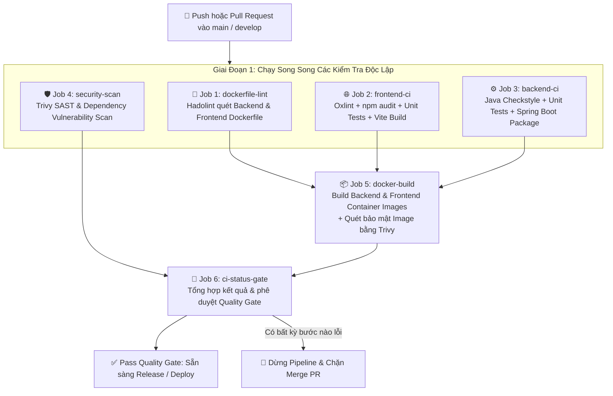

# 🚀 Hướng Dẫn Sử Dụng CI/CD Pipeline (GitHub Actions)

Tài liệu này cung cấp hướng dẫn toàn diện về hệ thống **Continuous Integration (CI) Quality Gate** chuẩn hóa dành cho dự án **JP Dictionary**.

---

## 📑 Mục Lục
1. [Triết lý thiết kế & Mục tiêu](#-triết-lý-thiết-kế--mục-tiêu)
2. [Kiến trúc & Chu trình kiểm thử (Workflow)](#-kiến-trúc--chu-trình-kiểm-thử-workflow)
3. [Chi tiết các Jobs trong Pipeline](#-chi-tiết-các-jobs-trong-pipeline)
4. [Hướng dẫn kiểm thử cục bộ trước khi Push (Local Testing)](#-hướng-dẫn-kiểm-thử-cục-bộ-trước-khi-push-local-testing)
5. [Hướng dẫn tích hợp & Sử dụng trên GitHub](#-hướng-dẫn-tích-hợp--sử-dụng-trên-github)
6. [Các bộ quy chuẩn chất lượng mã nguồn (Quality Rulesets)](#-các-bộ-quy-chuẩn-chất-lượng-mã-nguồn-quality-rulesets)
7. [Cẩm nang xử lý sự cố thường gặp (Troubleshooting)](#-cẩm-nang-xử-lý-sự-cố-thường-gặp-troubleshooting)

---

## 🎯 Triết lý thiết kế & Mục tiêu

Pipeline này được xây dựng theo nguyên tắc **"Người thật việc thật (Strict Quality Gates)"**:
- ❌ **Tuyệt đối KHÔNG sử dụng `continue-on-error: true`** hoặc toán tử che giấu lỗi `|| true`.
- 🛡️ **Fail-Fast**: Bất kỳ lỗi cú pháp, vi phạm quy ước viết mã (Coding conventions), thất bại Unit Test, lỗ hổng bảo mật cấp cao (CVE High/Critical) hoặc lỗi đóng gói Docker container đều sẽ **ngay lập tức đánh dấu Build thất bại** và chặn không cho merge vào nhánh chính.
- ⚡ **Tối ưu tốc độ**: Các công việc Frontend, Backend, Linting và Security Scan được thiết kế để chạy **hoàn toàn song song** trên các runner độc lập của GitHub.

---

## 🔄 Kiến trúc & Chu trình kiểm thử (Workflow)

Pipeline được định nghĩa tại tệp cấu hình: [`.github/workflows/ci.yml`](file:///d:/Project/jp-dictionary/.github/workflows/ci.yml).



---

## 🔍 Chi tiết các Jobs trong Pipeline

### 1. `dockerfile-lint` (Hadolint)
- **Mục đích**: Phân tích cú pháp Dockerfile theo cây cú pháp trừu tượng (AST) và thực thi các chuẩn thực hành tốt nhất về bảo mật container.
- **Tệp kiểm tra**: [`backend/Dockerfile`](file:///d:/Project/jp-dictionary/backend/Dockerfile) và [`frontend/Dockerfile`](file:///d:/Project/jp-dictionary/frontend/Dockerfile).
- **Bộ quy tắc**: Quản lý tại [`.hadolint.yaml`](file:///d:/Project/jp-dictionary/.hadolint.yaml) ở thư mục gốc.

### 2. `frontend-ci` (React 19 + Vite)
- **Môi trường**: Node.js 20 (bản LTS) với cơ chế cache npm dependencies.
- **Quy trình thực thi**:
  1. `npm ci`: Cài đặt thư viện chính xác 100% theo `package-lock.json`.
  2. `npm run lint`: Chạy **Oxlint** với cờ `--deny-warnings` (phát hiện biến thừa, cú pháp React không an toàn, vi phạm hooks).
  3. `npm audit --audit-level=high`: Rà soát cơ sở dữ liệu bảo mật npm, chặn các thư viện có lỗ hổng bảo mật nghiêm trọng.
  4. `npm test`: Thực thi bộ kiểm thử tự động của Node.js (`node --test src/**/*.test.js`).
  5. `npm run build`: Kiểm tra tính toàn vẹn của việc đóng gói tài nguyên tĩnh (HTML/CSS/JS chunks).
  6. **Lưu trữ Artifact**: Tự động upload thư mục `frontend/dist` lên GitHub Actions lưu trữ trong 7 ngày.

### 3. `backend-ci` (Spring Boot 3 + Java 21)
- **Môi trường**: Eclipse Temurin JDK 21 với cơ chế cache Maven repository.
- **Quy trình thực thi**:
  1. `./mvnw checkstyle:check`: Rà soát tĩnh toàn bộ mã nguồn Java theo luật [`backend/checkstyle.xml`](file:///d:/Project/jp-dictionary/backend/checkstyle.xml).
  2. `./mvnw test`: Chạy kiểm thử Spring Boot Context & Unit Tests qua profile test cách ly (không phụ thuộc Database bên ngoài).
  3. `./mvnw package -DskipTests`: Đóng gói file `.jar` chạy độc lập (Executable Fat Jar).
  4. **Lưu trữ Artifact**: Tự động upload file `.jar` hoàn thiện lên GitHub Actions lưu trữ trong 7 ngày.

### 4. `security-scan` (Trivy SAST & Dependency Audit)
- **Công cụ**: Aqua Security Trivy Scanner.
- **Mục đích**: Quét tĩnh toàn bộ cây thư mục mã nguồn và tệp khóa phiên bản (`package-lock.json`, `pom.xml`) để tìm các mã định danh lỗ hổng CVE phổ biến.
- **Tiêu chí**: Cấu hình `exit-code: 1` khi phát hiện lỗ hổng mức `CRITICAL` hoặc `HIGH`.

### 5. `docker-build` (Build & Image Security Scan)
- **Điều kiện chạy**: Chỉ chạy khi cả 3 Job `dockerfile-lint`, `frontend-ci` và `backend-ci` đều **PASS**.
- **Quy trình thực thi**:
  1. Thiết lập Docker Buildx builder.
  2. Build image Frontend từ [`frontend/Dockerfile`](file:///d:/Project/jp-dictionary/frontend/Dockerfile).
  3. Build image Backend từ [`backend/Dockerfile`](file:///d:/Project/jp-dictionary/backend/Dockerfile).
  4. Quét chính 2 Docker image vừa tạo ra bằng Trivy để đảm bảo Base Image OS không bị cài cắm mã độc hay CVE nghiêm trọng.

### 6. `ci-status-gate` (Cổng phê duyệt tổng thể)
- **Mục đích**: Tổng hợp kết quả từ tất cả các job trên. Đây là job duy nhất cần được cài đặt làm **Required Status Check** trong GitHub Branch Protection Rule.

---

## 💻 Hướng dẫn kiểm thử cục bộ trước khi Push (Local Testing)

Để tránh tình trạng đẩy commit lên GitHub rồi mới phát hiện lỗi, bạn có thể chạy toàn bộ các bước kiểm tra ngay trên máy cá nhân:

### Cách 1: Sử dụng Script 1-Click (Khuyến nghị trên Windows)

Chạy script PowerShell đã chuẩn bị sẵn ở thư mục gốc:

```powershell
powershell -ExecutionPolicy Bypass -File .\scripts\test-ci.ps1
```

Script sẽ tuần tự chạy:
- Frontend Lint (`oxlint`)
- Frontend Audit (`npm audit`)
- Frontend Unit Tests (`node --test`)
- Frontend Production Build (`vite build`)
- Backend Checkstyle (`mvnw checkstyle:check`)
- Backend Unit Tests (`mvnw test`)
- Backend Production Jar Package (`mvnw package`)

Nếu kết thúc với dòng thông báo **`ALL CI QUALITY GATES PASSED (100% GREEN)`**, bạn hoàn toàn tự tin đẩy code lên GitHub.

---

### Cách 2: Chạy thủ công từng phần

#### 🌐 Kiểm tra Frontend độc lập:
```bash
cd frontend

# 1. Quét lỗi cú pháp và style
npm run lint

# 2. Kiểm tra lỗ hổng bảo mật thư viện
npm audit --audit-level=high

# 3. Chạy kiểm thử tự động
npm test

# 4. Kiểm tra đóng gói build
npm run build
```

#### ⚙️ Kiểm tra Backend độc lập:
```bash
cd backend

# 1. Kiểm tra quy chuẩn mã nguồn Java
# (Trên Windows dùng mvnw.cmd, trên Linux/macOS dùng ./mvnw)
mvnw checkstyle:check

# 2. Chạy toàn bộ Unit Tests
mvnw test

# 3. Đóng gói sản phẩm
mvnw package -DskipTests
```

---

## 🌐 Hướng dẫn tích hợp & Sử dụng trên GitHub

### 1. Kích hoạt tự động khi làm việc với Git
Mỗi khi bạn thực hiện các thao tác sau, GitHub Actions sẽ tự động kích hoạt:
- **`git push`** lên các nhánh `main`, `master`, hoặc `develop`.
- **Tạo Pull Request (PR)** nhắm vào các nhánh `main`, `master`, hoặc `develop`.

Bạn có thể theo dõi tiến trình trực tiếp tại thẻ **Actions** trên giao diện kho lưu trữ GitHub:
`https://github.com/<tên-tài-khoản>/<tên-repo>/actions`

---

### 2. Kích hoạt thủ công từ giao diện Web (Manual Trigger)
Workflow hỗ trợ sự kiện `workflow_dispatch`:
1. Vào tab **Actions** trên GitHub.
2. Ở danh sách bên trái, chọn **Production CI Quality Gate**.
3. Nhấn vào nút **Run workflow** -> Chọn nhánh cần chạy -> Nhấn **Run workflow**.

---

### 3. Thiết lập Branch Protection Rule (Bảo vệ nhánh Main)
Để biến CI thành "người gác cổng" bắt buộc không ai có thể bỏ qua:
1. Vào mục **Settings** của repository trên GitHub.
2. Chọn **Branches** -> Nhấn **Add branch protection rule** (hoặc edit quy tắc của nhánh `main`).
3. Tích chọn:
   - ✅ **Require a pull request before merging**
   - ✅ **Require status checks to pass before merging**
   - Tại thanh tìm kiếm status checks, tìm và chọn:
     - `🏁 CI Quality Gate Status` (hoặc chọn tất cả các jobs: `dockerfile-lint`, `frontend-ci`, `backend-ci`, `security-scan`, `docker-build`).
   - ✅ **Require branches to be up to date before merging**
4. Nhấn **Save changes**.

> [!NOTE]
> Sau khi thiết lập xong, bất kỳ Pull Request nào có code vi phạm (dù chỉ là 1 lỗi format Java hay 1 test bị fail) đều sẽ bị GitHub khóa nút **Merge**, bắt buộc lập trình viên phải sửa lỗi trên máy rồi mới được merge.

---

## 📏 Các bộ quy chuẩn chất lượng mã nguồn (Quality Rulesets)

### 1. Quy tắc Java Checkstyle ([`backend/checkstyle.xml`](file:///d:/Project/jp-dictionary/backend/checkstyle.xml))
- **Độ dài dòng tối đa**: 120 ký tự (trừ dòng khai báo `package`, `import`, hoặc link URL).
- **Quy tắc Import**:
  - Nghiêm cấm dùng Wildcard import: `import java.util.*;` ❌ (phải import chính xác class cần dùng).
  - Không cho phép import thừa hoặc import trùng lặp.
- **Độ phức tạp Cyclomatic**: Tối đa 10 cho mỗi method (phương thức quá nhiều rẽ nhánh if/else/switch lồng nhau sẽ bị chặn).
- **Quy tắc đặt tên (Naming)**: Tuân thủ chuẩn mực Java (CamelCase cho class, method, variable; UPPER_SNAKE_CASE cho hằng số).
- **Khối lệnh & Dấu ngoặc nhọn**: Bắt buộc phải có dấu ngoặc nhọn `{}` cho các câu lệnh rẽ nhánh `if`, `for`, `while`, không viết code gộp dòng.

### 2. Quy tắc Frontend Linter (Oxlint)
- Cấm để biến/hàm được khai báo nhưng không sử dụng (`no-unused-vars`).
- Kiểm tra các quy tắc nghiêm ngặt của React Hooks (`react-hooks/rules-of-hooks`, `react-hooks/exhaustive-deps`).
- Phát hiện các cú pháp có nguy cơ gây lỗi rò rỉ bộ nhớ hoặc re-render vòng lặp.

### 3. Quy tắc Dockerfile ([`.hadolint.yaml`](file:///d:/Project/jp-dictionary/.hadolint.yaml))
- Áp dụng kỹ thuật **Multi-stage build** để tách biệt môi trường build cồng kềnh với môi trường chạy (runtime) siêu nhẹ.
- **Không chạy bằng user `root`** ở môi trường runtime (backend chạy bằng `appuser:appgroup`).
- Bắt buộc khai báo lệnh **`HEALTHCHECK`** định kỳ để giám sát tình trạng sống/chết của container.
- Cố định phiên bản base image (sử dụng `eclipse-temurin:21-jre-alpine` và `nginx:1.27-alpine`, tránh dùng tag `:latest` trôi nổi).

---

## 🩺 Cẩm nang xử lý sự cố thường gặp (Troubleshooting)

### 1. Lỗi Checkstyle báo dòng quá dài (> 120 ký tự)
- **Triệu chứng**:
  ```text
  [ERROR] ...: Line is longer than 120 characters (found 125). [LineLength]
  ```
- **Cách khắc phục**:
  Ngắt dòng các tham số dài trong khai báo method, chuỗi string hoặc điều kiện logic:
  ```java
  // ❌ Trước (124 ký tự)
  public ResponseEntity<ApiResponse<Map<String, String>>> handleValidationExceptions(MethodArgumentNotValidException ex) {

  // ✔ Sau (Ngắt dòng hợp lý)
  public ResponseEntity<ApiResponse<Map<String, String>>> handleValidationExceptions(
          MethodArgumentNotValidException ex) {
  ```

---

### 2. Lỗi Checkstyle báo cấm import wildcard (`*`)
- **Triệu chứng**:
  ```text
  [ERROR] ...: Using the '.*' form of import should be avoided - java.util.*. [AvoidStarImport]
  ```
- **Cách khắc phục**:
  Chỉnh sửa trong IDE (IntelliJ IDEA / VS Code / Eclipse):
  - Nhấn `Alt + Shift + O` (VS Code) hoặc `Ctrl + Alt + O` (IntelliJ) để Optimize Imports.
  - Thay thế `import java.util.*;` thành các class cụ thể: `import java.util.List;`, `import java.util.Map;`.

---

### 3. Lỗi Frontend `npm audit` báo phát hiện lỗ hổng bảo mật
- **Triệu chứng**:
  ```text
  npm error code EAUDITNOPERM
  1 high severity vulnerability found
  ```
- **Cách khắc phục**:
  1. Chạy `npm audit` ở thư mục `frontend` để xem chi tiết package bị dính CVE.
  2. Thử nâng cấp tự động:
     ```bash
     cd frontend
     npm audit fix
     ```
  3. Nếu không fix được tự động, nâng cấp thủ công phiên bản package đó trong `package.json` lên phiên bản đã vá lỗi.

---

### 4. Lỗi Hadolint báo lỗi cú pháp Dockerfile
- **Triệu chứng**:
  ```text
  backend/Dockerfile:12 error: DL3008 Pin versions in apt-get install
  ```
- **Cách khắc phục**:
  Kiểm tra xem rule đó có cần ignore trong `.hadolint.yaml` không, hoặc sửa Dockerfile để dùng cờ `--no-cache` / `--no-install-recommends` theo đúng khuyến nghị của Hadolint.

---

### 5. Lỗi Backend Unit Test thất bại khi thiếu Database
- **Triệu chứng**:
  Test Spring Boot fail vì không kết nối được tới cơ sở dữ liệu MySQL thật.
- **Cách khắc phục**:
  Dự án đã cấu hình sẵn tệp [`backend/src/test/resources/application-test.yml`](file:///d:/Project/jp-dictionary/backend/src/test/resources/application-test.yml) tự động loại bỏ cấu hình DataSource/Flyway trong môi trường test:
  ```yaml
  spring:
    flyway:
      enabled: false
    autoconfigure:
      exclude:
        - org.springframework.boot.autoconfigure.jdbc.DataSourceAutoConfiguration
        - org.springframework.boot.autoconfigure.orm.jpa.HibernateJpaAutoConfiguration
        - org.springframework.boot.autoconfigure.flyway.FlywayAutoConfiguration
  ```
  Đảm bảo class test luôn gắn annotation:
  ```java
  @SpringBootTest
  @ActiveProfiles("test")
  class JpDictionaryApplicationTests { ... }
  ```

---

### 6. Lỗi Trivy Scan báo lỗ hổng bảo mật hoặc lỗi tải Database
- **Triệu chứng 1**: Pipeline bị fail tại bước Trivy do các gói hệ điều hành trong Docker image (Alpine OS) hoặc thư viện chứa CVE mức CRITICAL/HIGH.
  - **Nguyên nhân**: Mặc định Trivy báo cáo cả các CVE mà bên phát triển hệ điều hành **chưa có bản vá (unpatched / won't fix)**.
  - **Cách khắc phục**:
    1. Pipeline đã được cấu hình cờ `--ignore-unfixed`: Trivy sẽ **chỉ chặn** các lỗ hổng **đã có bản vá chính thức** mà dự án chưa nâng cấp.
    2. Cả `backend/Dockerfile` và `frontend/Dockerfile` đã được bổ sung lệnh `RUN apk update && apk upgrade --no-cache` để cập nhật tự động các gói thư viện OS mới nhất.
    3. Nếu gặp một CVE không thể khai thác (false-positive) hoặc đang chờ thư viện bên thứ ba cập nhật, bạn có thể thêm mã CVE đó vào tệp [`.trivyignore`](file:///d:/Project/jp-dictionary/.trivyignore) ở thư mục gốc:
       ```text
       # .trivyignore
       CVE-202X-XXXX
       ```
- **Triệu chứng 2**: Trivy fail do lỗi `HTTP 429 Too Many Requests` hoặc network timeout khi tải database lỗ hổng.
  - **Nguyên nhân**: GitHub runner dùng chung IP bị giới hạn tần suất gọi API (Rate limit) khi tải database từ GHCR.
  - **Cách khắc phục**: Pipeline đã sử dụng action chuẩn `aquasecurity/setup-trivy@v0.2.2` với `github-token: ${{ secrets.GITHUB_TOKEN }}` và bật `cache: true` để lưu cache DB, triệt tiêu hoàn toàn lỗi rate limit.

---

## 📦 Tải xuống Artifacts sau khi CI chạy thành công

Sau khi pipeline hoàn tất thành công trên GitHub Actions:
1. Mở trang chi tiết của lần chạy workflow (Run details).
2. Cuộn xuống mục **Artifacts** ở cuối trang:
   - **`frontend-dist`**: Chứa toàn bộ mã nguồn frontend đã được minify và tối ưu sẵn để copy vào CDN hoặc hosting.
   - **`backend-jar`**: Chứa file file `.jar` Spring Boot đã được đóng gói hoàn chỉnh, sẵn sàng đem đi triển khai lên Server/Docker.
